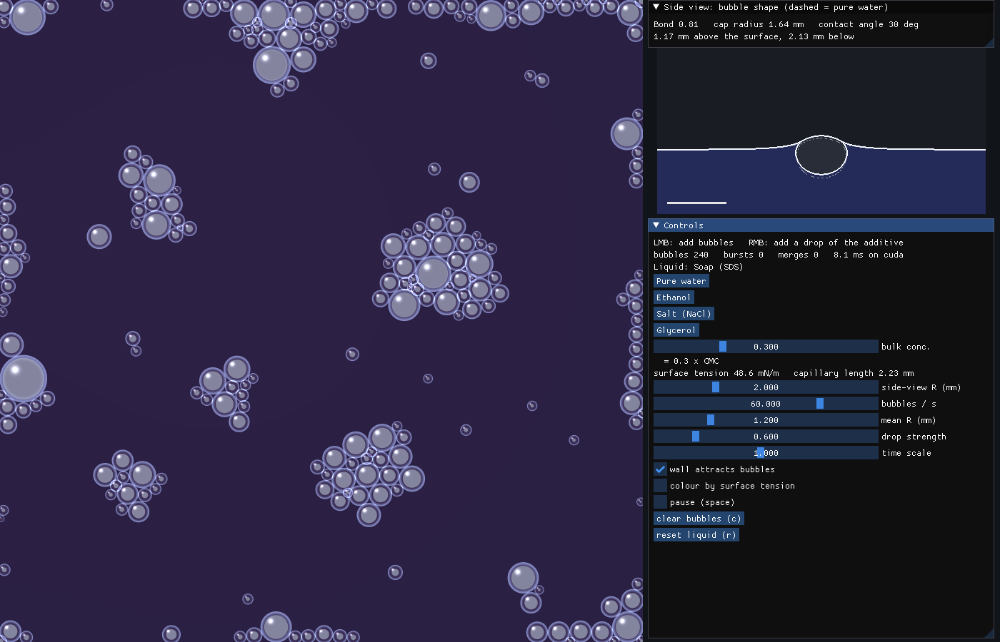

# Water bubble

An interactive GPU simulation of bubbles floating on a liquid surface, showing
how dissolved substances change their behaviour through surface tension, film
stability and viscosity.



The point it makes: **low surface tension does not mean long-lived bubbles.**
Soap and ethanol both lower the surface tension of water, but soap bubbles last
for minutes while bubbles on an ethanol solution burst faster than on clean
water. What keeps a bubble alive is the stability of its thin film, not the
tension value.

## Run

Needs [uv](https://docs.astral.sh/uv/) and a GPU (CUDA or Vulkan; Taichi falls
back to the CPU if neither is available).

```bash
uv run main.py
```

The first start solves the bubble shape table (about 15 s) and caches it in
`yl_table.npz`.

| Input | Action |
|---|---|
| Left mouse button | add bubbles at the cursor |
| Right mouse button | add a drop of the current additive |
| `Space` | pause |
| `C` | clear bubbles |
| `R` | reset the liquid to the bulk concentration |
| `Esc` | quit |

The panel on the right selects the liquid (pure water, soap, ethanol, salt,
glycerol), its concentration, the bubble emission rate and size, and the time
scale. The side view above it shows the equilibrium cross-section of a single
bubble in the current liquid, with the same bubble in pure water dashed.

## What you can see

- **Rafts**: bubbles attract each other and the walls through the menisci they
  create (the "Cheerios effect"), over a range set by the capillary length
  `sqrt(gamma / (rho g))`.
- **Shape**: small bubbles sit almost fully submerged as spheres, large ones
  form a dome. The shape depends only on `R / l_c`, so lowering the surface
  tension makes a bubble of the same volume flatter.
- **Marangoni flow**: a drop of soap or ethanol lowers the tension locally and
  the surface flows outward, sweeping bubbles away.
- **Lifetime**: the colour rings on each cap are thin-film interference; they
  move faster as the film drains, and the bubble bursts when it gets too thin.
- **Coalescence**: touching bubbles merge quickly in clean water, rarely in
  soap or salt solutions.

## Model

A reduced-order model, not a CFD solver. Each bubble is a particle on a 2D
surface; the additive is a concentration field on a grid. The sections below
give the physics in the order it acts, and each one says whether it comes from
theory or was tuned by hand.

Symbols: $\gamma$ surface tension, $\rho$ liquid density, $g$ gravity, $\mu$
viscosity, $R$ the radius of a sphere with the bubble's volume, $c$ the
additive concentration normalised so that $c = 1$ is the reference amount in
the table below.

### 1. Surface tension and the capillary length

Surface tension is the energy cost of liquid surface per unit area, or
equivalently a force per unit length pulling along the surface. Gravity tries
to flatten the surface, surface tension resists bending it, and the length at
which the two balance is the capillary length

```math
l_c = \sqrt{\frac{\gamma}{\rho g}}
```

about 2.7 mm for clean water. It is the single most important scale here:
menisci extend about one $l_c$, bubbles much smaller than $l_c$ are held
spherical by surface tension, and bubbles much larger are flattened by
gravity. The ratio is usually quoted as the Bond number
$\mathrm{Bo} = \rho g R^2 / \gamma = (R / l_c)^2$.

Every additive changes $\gamma$ through one fitted law,

```math
\gamma(c) = \gamma_w + A \, \frac{\ln(1 + B c)}{\ln(1 + B)}, \qquad 0 \le c \le 1
```

with $\gamma_w = 72.8$ mN/m. $A$ is the total change at $c = 1$ and $B$ sets
how much of it happens at low concentration (a small $B$ gives a straight
line). The values are fits to handbook data.

| Additive | $c = 1$ means | $\gamma$ at $c = 1$ (mN/m) | Other effect |
|---|---|---|---|
| Soap (SDS) | the critical micelle concentration | 35.0 | stabilises films |
| Ethanol | pure ethanol (mass fraction 1) | 22.0 | antifoam |
| Salt (NaCl) | 6 mol/L | 82.6 | inhibits coalescence |
| Glycerol | pure glycerol (mass fraction 1) | 63.4 | raises viscosity |

Soap acts strongly at tiny concentrations and stops at the critical micelle
concentration, where extra soap forms micelles in the bulk instead of going to
the surface; the law is therefore held flat above $c = 1$. Salt is the odd
one: ions avoid the surface, so it raises the tension slightly.

### 2. Shape of a floating bubble

A bubble at rest on a surface has three interfaces: the submerged **wall**
between gas and liquid, the thin-film **cap** between gas and air, and the
**meniscus** of the liquid surface around it. Each obeys the Young-Laplace
law, which says the pressure jump across an interface equals $\gamma$ times
its total curvature. Writing lengths in units of $l_c$ and pressures in units
of $\gamma / l_c$, with $z$ measured up from the undisturbed surface and $P$
the gas pressure above atmospheric:

- **Wall.** The liquid pressure at height $z$ is $-z$ (hydrostatic), so the
  jump is $P + z$. For a curve of revolution with tangent angle $\varphi$ and
  arc length $s$:

  ```math
  \frac{d\varphi}{ds} + \frac{\sin\varphi}{r} = P + z
  ```

- **Cap.** The film has two faces, so it carries tension $2\gamma$ and is a
  piece of a sphere of radius $4 / P$, twice that of a single interface at the
  same pressure.

- **Meniscus.** With $\psi$ the downward slope angle going outward,

  ```math
  \frac{d\psi}{ds} + \frac{\sin\psi}{r} = -z
  ```

  and it must decay to $z = 0$ far away.

The three meet in a ring. Force balance there ($2\gamma$ from the film against
$\gamma$ each from wall and meniscus) is only possible if all three are
tangent to one another, which closes the problem. `bubble_shape.py` integrates
the wall upward from the bottom of the bubble, finds where a cap of the right
radius joins it tangentially, and adjusts the depth of the bubble by bisection
until the meniscus leaving that ring decays to the far level.

Because the equations contain no parameter after scaling, the shape depends on
$R / l_c$ alone. Lowering the surface tension shrinks $l_c$, so a bubble of
the same volume behaves like a larger one: flatter, with a wider cap. For
small bubbles the solver reproduces the known limits to four digits,

```math
r_{cap} = \frac{2}{\sqrt{3}} \frac{R^2}{l_c}, \qquad Q = \frac{2}{3} \frac{R^3}{l_c^2}
```

and for large ones it tends to a hemispherical dome. This part is first
principles, with no tuned constants.

### 3. Capillary attraction (the Cheerios effect)

Buoyancy pushes a bubble up against the surface and raises a small hill of
liquid around it. Far from the bubble the hill has the form
$z(r) = Q \, K_0(r / l_c)$, where $K_0$ is a modified Bessel function that
falls off like $e^{-r / l_c}$. The amplitude $Q$, the "capillary charge", is
taken from the shape solution above.

A second bubble on that slope rises along it, as buoyancy drives it uphill, so
the two approach each other. Superposing the two hills (Nicolson's
approximation) gives the attractive force

```math
F = \frac{2 \pi \gamma \, Q_i Q_j}{l_c} \, K_1\!\left(\frac{d}{l_c}\right)
```

at centre distance $d$. A wetted tank wall has a meniscus of its own, of height
about $l_c$ decaying as $e^{-x / l_c}$, and attracts a bubble at distance $x$
with $F = 2 \pi \gamma \, Q \, e^{-x / l_c}$.

The formulas are theory, valid when bubbles are far apart compared with their
size. Near contact they overestimate the force for bubbles larger than $l_c$,
so the force is capped at $\gamma$ times the smaller bubble's radius. That cap
is a modelling choice.

### 4. Marangoni flow

Where the surface tension is uneven, the high-tension side pulls harder and
the surface flows toward it. A drop of soap or ethanol lowers the tension
locally, so the surface rushes outward and carries the additive and any
bubbles with it. The model takes the surface velocity proportional to the
tension gradient,

```math
\mathbf{u}_s = K_M \nabla \gamma
```

Since this flow transports the additive, and $\gamma$ depends on $c$, the
transport $c \, \mathbf{u}_s = K_M \, c \, \gamma'(c) \nabla c$ acts as a
diffusion whose strength depends on the concentration:

```math
\frac{\partial c}{\partial t} = \nabla \cdot \Big[ \big( D_0 + K_M \, c \, |\gamma'(c)| \big) \nabla c \Big] + \frac{c_{bulk} - c}{\tau_{bulk}}
```

$D_0$ is a small background mixing, and the last term is slow exchange with
the liquid below the surface. The diffusivity vanishing at $c = 0$ gives the
sharp spreading front seen on screen. For an additive that raises the tension
the Marangoni term is left out, as it would un-mix the liquid.

The direction and form are physical; $K_M$, $D_0$ and $\tau_{bulk}$ are tuned
so that a drop spreads across the tank in a few seconds.

### 5. Bubble motion

Each bubble obeys Newton's law in the plane of the surface:

```math
m \frac{d\mathbf{v}}{dt} = \mathbf{F}_{capillary} + \mathbf{F}_{contact} - \zeta \, (\mathbf{v} - \mathbf{u}_s)
```

- The gas is weightless, but moving the bubble means moving liquid out of the
  way. This added mass is half the displaced liquid for a sphere:
  $m = \tfrac{1}{2} \rho \cdot \tfrac{4}{3} \pi R^3$.
- Drag is proportional to the velocity relative to the surface flow, which is
  how Marangoni flow moves bubbles. The coefficient is
  $\zeta = 3 \pi \mu R \, (1 + 0.15 \, \mathrm{Re}^{0.687})$: half the Stokes
  drag of a fully immersed sphere, times the Schiller-Naumann correction for
  Reynolds numbers above one.
- Touching bubbles repel like stiff springs and are prevented from
  overlapping. They do not deform, so a raft is packed circles, not polygons.

The drag law is standard; the factor of one half and the rigid contact are
simplifications.

### 6. Film drainage and bursting

The cap is a liquid film a few micrometres thick. Liquid drains out of it
under gravity and capillary suction, and it bursts when it gets thin enough
for a random disturbance to puncture it. The model thins each film
exponentially,

```math
\frac{dh}{dt} = -\frac{h}{\tau_d}, \qquad \tau_d = \tau_w \; \xi \; \frac{\mu}{\mu_w} \, \big( 1 + 40 \, S(c) \big) \, \big( 1 - a(c) \big)
```

starting from 10 µm. The factors are what decides a bubble's life:

- **Viscosity** $\mu / \mu_w$: thicker liquid drains more slowly (glycerol).
- **Stability** $S(c) = s_{max} \, c / (c + s_{1/2})$, between 0 and 1.
  Surfactant molecules on the film faces resist being swept along, which turns
  free-slipping surfaces into rigid ones and slows drainage enormously. This,
  not the lower tension, is why soap bubbles last.
- **Antifoam** $a(c)$: ethanol lowers the tension without stabilising the film
  and in fact shortens its life.
- $\xi$ is a random factor per bubble, so lifetimes are spread out.

A film bursts for certain below 0.1 µm, and before that with a probability per
second that rises as $(0.3\,\mu\mathrm{m} / h)^2 / \tau_d$. Bubbles above
12 mm radius are removed.

This whole section is phenomenological. The ingredients are the right ones and
the ranking of the liquids is realistic, but the lifetimes are not calibrated.

### 7. Coalescence

Two touching bubbles are separated by a liquid film that must drain before
they merge. The merge rate per touching pair is

```math
k = \frac{0.8 \ \mathrm{s^{-1}}}{\mu / \mu_w} \cdot \frac{(1 - S)^6}{1 + (c / c_{inh})^2}
```

so it is fast in clean water, almost zero with surfactant, and suppressed by
salt above a transition concentration near 0.1 mol/L, a well-known but still
debated effect that is why sea water foams and fresh water does not. Merging
conserves volume. The rate law is tuned.

### 8. Film colours

The rings on each cap are computed, not decorative. Light reflected from the
front and back of a film of thickness $h$ interferes, with reflected intensity
proportional to $\sin^2(2 \pi n h / \lambda)$ for refractive index $n = 1.33$.
Evaluating this for red, green and blue gives the colour. The film is taken
thinner at the top of the cap, which produces rings that move as it drains.

## How the simulation works

### Data

| What | Representation |
|---|---|
| Tank | 100 mm square of liquid surface, seen from above |
| Additive | concentration on a 256 x 256 grid |
| Bubbles | a pool of 2048 slots: position, velocity, radius, film thickness |
| Bubble shapes | a table of 56 Young-Laplace solutions against $R / l_c$ |

Everything runs on the GPU through [Taichi](https://www.taichi-lang.org/),
which compiles the Python functions marked as kernels to CUDA or Vulkan.
Internally the units are millimetres, milligrams and seconds, in which water
has density 1 and viscosity 1.

### Start-up

`bubble_shape.py` solves the bubble shape for 56 sizes with SciPy and caches
the result. From each solution the simulation keeps three ratios: the cap
radius, the widest radius and the capillary charge. These are uploaded to the
GPU as a lookup table, so the expensive differential equations are solved once
and never during the run.

### One frame

Each frame advances the model by 1/60 s times the time scale, in this order:

1. **Additive transport.** The concentration equation of section 4 is stepped
   with an explicit finite-volume scheme, where each cell exchanges additive
   with its four neighbours and the tank walls let nothing through. Explicit
   schemes are only stable for time steps below $\Delta x^2 / 4D$, and fast
   Marangoni spreading makes $D$ large, so one frame takes up to a few hundred
   small steps. This is the most expensive part and the main use of the GPU.

2. **Bubble motion**, repeated 8 times with a step of 1/480 s:
   - *Look up.* Each bubble samples the concentration and its gradient under
     itself, which gives the local $\gamma$ and $l_c$, and reads its shape
     ratios from the table. A bubble drifting into soapy liquid therefore
     changes size on screen and attracts its neighbours differently.
   - *Forces.* Every bubble sums the capillary and contact forces from every
     other bubble and from the four walls. This is all pairs, about four
     million per pass, one GPU thread per bubble.
   - *Move.* Velocities and positions are updated. Drag is treated implicitly,
     because for small bubbles it acts faster than the time step and an
     explicit update would be unstable.
   - *Separate.* Any remaining overlaps are pushed apart.

3. **Films.** Each film is thinned, and the random test for bursting is made.

4. **Coalescence.** Merging changes two bubbles at once, which is unsafe when
   every bubble is handled by a separate thread. It is done in two passes: each
   bubble first picks at most one touching neighbour, using a random number
   that both members of a pair compute identically, and then only pairs that
   picked each other are merged.

5. **Drawing.** The frame is rendered on the GPU into a single image. Each
   bubble paints the pixels of its own bounding box; the side view classifies
   every pixel as air, liquid or gas from the tabulated profile.

A frame takes 4 to 10 ms on an RTX 5070 Ti.

### Checks

- The shape solver is compared with the analytic small-bubble limits each time
  the table is built (`uv run python bubble_shape.py`).
- The GPU Bessel function is compared with SciPy.
- `uv run main.py --test out` runs every liquid for 10 s of model time and
  reports bubble counts, bursts, merges and whether any value became
  non-finite.

### Limits

- One additive at a time; mixtures are not modelled.
- Bubbles keep a circular footprint and do not deform against each other.
- The liquid below the surface is not simulated: no bulk flow, no rising
  bubbles, no waves.
- Attraction is summed pairwise, which overestimates it inside dense rafts.
- Sections 6 and 7 and the constants of section 4 are tuned by hand, so
  lifetimes and spreading speeds are qualitative.

## Files

| File | Contents |
|---|---|
| `main.py` | window, controls, scripted test |
| `sim.py` | Taichi fields and kernels: concentration field, bubble dynamics, rendering |
| `bubble_shape.py` | Young-Laplace shape solver and lookup table |

`uv run main.py --test out` runs every liquid for 10 s of model time without a
window, prints bubble counts and writes frames to `out/`.
`uv run python bubble_shape.py` rebuilds the shape table and prints the checks
against the analytic limits.
